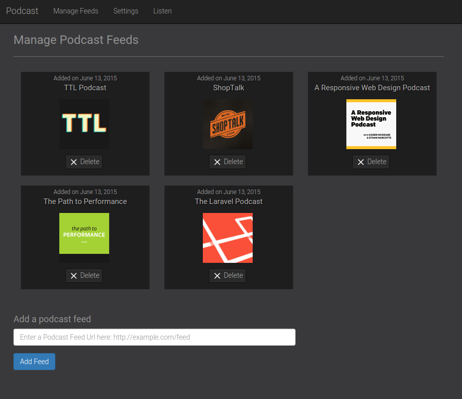
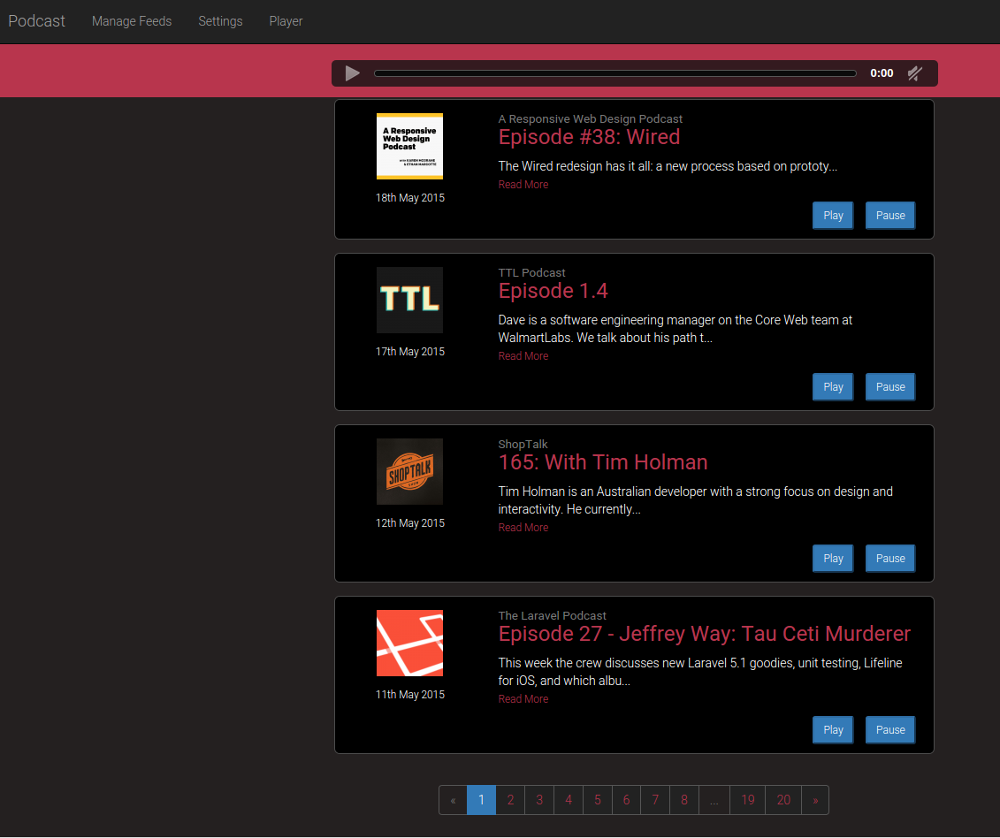

# Podcastwala

A self-hosted podcast web application built with Laravel. Subscribe to podcast RSS feeds, manage episodes, and listen to audio directly in your browser.

## Features

- Subscribe to any podcast via RSS feed URL
- Automatic feed parsing with thumbnail extraction
- Built-in HTML5 audio player
- Mark episodes as read / mark all previous as read
- Favorite episodes for quick access
- Search across episode titles and descriptions
- Scheduled automatic feed updates (twice daily)
- Per-user podcast subscriptions (multi-user support)
- Mobile-responsive UI

## Screenshots

| Manage Feeds | Player |
|---|---|
|  |  |

## Requirements

- PHP 8.2+
- Composer
- Node.js 18+ & npm
- SQLite (default) or MySQL/PostgreSQL

## Installation

```bash
# Clone the repository
git clone https://github.com/modestkdr/Podcastwala.git
cd Podcastwala

# Install PHP dependencies
composer install

# Install JS dependencies
npm install

# Configure environment
cp .env.example .env
php artisan key:generate

# Run database migrations
php artisan migrate

# Build frontend assets
npm run build

# Start the development server
php artisan serve
```

Visit `http://localhost:8000`, register an account, and start adding podcast feeds.

## Usage

1. **Register/Login** - Create an account to get started
2. **Add Feeds** - Go to "Manage Feeds" and paste a podcast RSS URL
3. **Listen** - Click "Listen" to see your unread episodes and play audio
4. **Favorites** - Star episodes to find them later in the Favorites tab
5. **Search** - Search across all your subscribed episode titles and descriptions

## Auto-updating Feeds

New episodes are fetched automatically via a scheduled command. Add this cron entry to your server:

```
* * * * * cd /path-to-project && php artisan schedule:run >> /dev/null 2>&1
```

Or trigger a manual update:

```bash
php artisan podcasts:update
```

## Running Tests

```bash
php artisan test
```

Tests use an in-memory SQLite database and cover models, controllers, authentication, and authorization.

## Tech Stack

- **Backend**: Laravel 11, PHP 8.2+
- **Frontend**: Bootstrap 3, jQuery, HTML5 Audio
- **Build**: Vite
- **Database**: SQLite (default), MySQL, PostgreSQL
- **Feed Parsing**: SimplePie (via willvincent/feeds)
- **Image Processing**: Intervention Image 3

## License

This project is open-sourced software licensed under the [MIT license](http://opensource.org/licenses/MIT).
